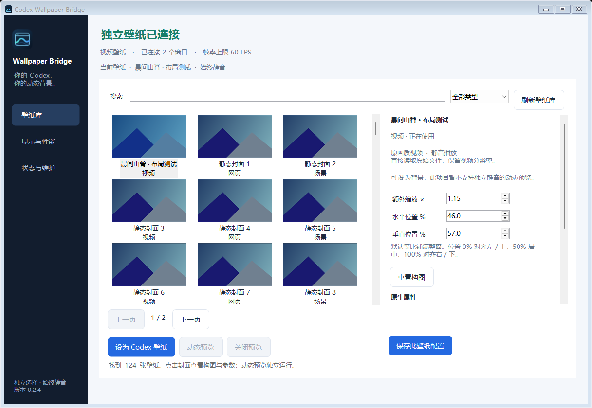

# Codex Wallpaper Bridge

Windows 独立壁纸管理程序。在 Bridge 中选择 Codex 专用壁纸，桌面 Wallpaper Engine 保持原来的选择、参数和声音设置；不修改官方 Codex 安装文件。

**2026-10-19补充收尾：0.3.0本机自用范围完成。** 186项测试及语法通过；实窗素材缺失、播放器启动失败/异常退出、主动停止/退出均恢复Codex原貌，三项运行风险已关闭。修改、证据、产物及未完成部分见[收尾记录](docs/CLOSEOUT-0.3.0.zh-CN.md)。多屏、全天及扩展已移出门槛；发布、安装、Git提交/推送暂不执行。下述179项和耐久为收尾前历史证据，`fullPrdAccepted:false`保持。

**当前为 0.3.0 本机验证候选，未公开发布。** 2026-10-19源码已通过186项测试、语法检查、真实最大化/还原合成与六来源实体双窗验证。Codex26.1013.4894.0 / WE2.8.0.42下完成3735.771秒、24轮、351次双窗采样，覆盖9视频、4次Sheep及跨卷Scene，原资源、桌面和用户进程保持；42个worker、36个runtime全部回收。资源指标通过原门槛，没有强制GC或降画质。历史32项非Video矩阵、685秒记录及旧候选保留；本轮新包复用相同已验native八产物，归档/源码重建/隔离卸载结果见[收尾记录](docs/CLOSEOUT-0.3.0.zh-CN.md)。完整PRD仍为 `fullPrdAccepted:false`，跨屏、全天和任意项目兼容未证明，详见[验收记录](docs/ACCEPTANCE.zh-CN.md)。

## 当前开发源码的播放范围

| 类型 | 实现与已取得的证据 | 边界 |
| --- | --- | --- |
| Video | 原文件交给 Codex 的 Chromium 媒体解码器，赋 `src` 前静音，保留原始分辨率 | 不用逐帧 JPEG 代替正常视频解码；实际帧率取决于来源和负载 |
| Scene | 已核验的 WE 2.8.0.42 x64 在私有目录、配置与宿主窗口中启动，恢复执行前设置 `videoaudiooutput:false`；本机29个Scene矩阵保留，新增跨卷自绘Scene双窗播放/精确清理通过 | 跨卷时在素材父目录建立私有硬链接视图，要求父目录可写、文件系统支持硬链接；未知引擎拒绝，任意项目、跨屏及全天兼容性未证明 |
| 原生 Web | 同一私有静音 WE 路径保留原生网页接口；鼠标通过私有 CEF loopback CDP，文档身份在私有 world 中验证 | 端口进程必须属于自有 Job，导航/文档身份不符时拒绝输入；不保证所有硬件或作者接口 |
| Web 兼容后端 | 隔离静音 Edge；已实现真实 WASAPI 立体声频谱、GSMTC 媒体信息、文件/目录与随机文件、目录变更、FPS 和暂停回调 | 使用真实系统数据，不伪造频谱、歌曲或文件；仍未覆盖的接口明确报告不可用 |
| Application | 仅审核的内置 Sheep / Unity 2017.2.0f3：启动前私有禁声；统一构建后的动态/音频采样、640×360 尺寸和 5 次真实点击定向通过；实体双窗及 4 次耐久切换、隐藏重建、原素材/桌面配置/清理通过 | 只限审核 Sheep，未知应用拒绝；不概括为任意 Application 支持 |

壁纸库读取 Steam 多库、Workshop、本地和内置项目的元数据及封面。可保存每项目构图与属性；文件/目录属性只有在用户明确选择并保存后才授予外部路径访问，作者默认路径不等于用户授权。

鼠标只转发受信的移动与左键点击，按 Cover、缩放和位置逆映射；不拦截聊天输入、不读取聊天内容、不转发键盘或拖拽。隐藏、失焦、过期和旧代次输入会丢弃。Scene、Web 和审核 Sheep 均有定向实测；Sheep 已修复 DPI 裁切并使用私有轮询输入，不依赖激活窗口或焦点 hook。这些结果仍不替代最终构建和真实 Codex 集成验收。

## 使用

1. 从旧 Bridge 托盘选择“退出并恢复”，再启动要使用的完整程序目录。已有 0.2.4 包仍可用于其历史能力；开发扩展需要当前源码构建，不能只替换单个文件。
2. 在“壁纸库”搜索或筛选，选择项目后点击“设为 Codex 壁纸”。右侧说明当前播放方式和限制。
3. 需要客户端连接时，在“状态与维护”点击“以连接模式启动 Codex”。版本检查和页面结构检查仍须通过；候选适配器需要显式开启，不能据此视为正式验证。
4. 为每张壁纸保存缩放、水平/垂直位置与属性。“动态预览”只对通过当前启动检查的来源开放，关闭预览释放自有资源。
5. 关闭设置后驻留托盘；完全退出用“退出并恢复”。新安装的背景与自启动默认关闭，不会自动导入桌面选择。

“显示与性能”提供 30/60/120 FPS 和自动上限，默认 60；不透明度、亮度、对比度默认 100%，模糊默认 0。帧率设置是上限，不承诺达到固定帧率。多个窗口共享图像来源，视频由各客户端独立解码。所有窗口不可见时释放独立来源，恢复时重建；不向桌面 WE 发送全局静音、暂停或更换壁纸命令。

当前设置界面已完成 96 DPI 虚拟化及本机实际 144 DPI 各 126 项 fixture 检查，并核对屏幕实拍，包含新后端状态、文件/目录属性和最小窗口布局。这不是跨显示器或真实 Codex 双窗验收。

## 构建与验证

需要 Windows x64、Node.js 22.15+、.NET Framework 4.8 编译器、系统 WinMetadata 和 MinGW-w64 GCC。新的 Sheep 输入路径另需 i686 Windows 编译器：通过 `BRIDGE_I686_CC` 指定可用的 i686 MinGW-w64 GCC/Clang，单独运行 `scripts/build-app-input.ps1` 时也可传 `-Compiler <绝对路径>`。脚本核验目标架构，不自动下载安装工具。发行打包要求已审阅的 Node v24.19.0。

主构建调用该输入构建脚本，生成 `BridgeApplicationInput.dll` 和 `BridgeApplicationInputHook32.dll`。统一原生构建与 Sheep 验证已通过；最新源码的自动测试为 179/179，语法检查通过。V5 二进制帧响应降低了实机内存增长，原始 Video 解码与既定画质预算保持。以下命令是各自的验证入口。

```powershell
npm test
npm run check
npm run build
npm run test:service
npm run test:manager
powershell.exe -NoProfile -STA -File scripts/property-file-ui-smoke.ps1
```

浏览器验收需要 Playwright；可用 `BRIDGE_PLAYWRIGHT_MODULE` 和 `BRIDGE_BROWSER_PATH` 指定现有依赖。播放矩阵、物理双窗、包含 Application 的耐久与新版包卸载验收应分别执行并记录，不能将库扫描、拒绝启动或单测通过当作播放成功。

`scripts/independent-environment.ps1` 仅在用户已授权临时环境操作后使用：按实际基线处理普通屏保、保持测试桌面活动，结束后停止 helper 并核对设置；`-BridgeNotRunning` 适用于测试前没有 Bridge 的情况。管理 UI fixture 会改变窗口激活，不能和物理 Codex 窗口测试同时运行。0.3.0 使用独立输出目录，保留 0.2.4 及 `dist/candidates/` 中的早期候选；最终包另以精确清单/哈希、源码重建和隔离卸载验证。

## 数据、更新与卸载

数据位于 `%LOCALAPPDATA%/CodexWallpaperBridge`，MSIX 环境可能重定向至 LocalCache。诊断不包含聊天、登录资料或工作文件。更新沿用签名、哈希、健康检查与失败回滚机制；默认没有公共更新源，开发包未进行发行者代码签名。

安装版从 Windows“已安装的应用”或开始菜单卸载；便携版运行包内 `Uninstall.exe`。卸载恢复外观，仅按清单删除程序文件，保留个人数据和用户新增文件。详见 [卸载说明](docs/UNINSTALL.zh-CN.md)。

## 0.2.4 历史交付

0.2.4 已交付侧栏导航、封面网格、构图/属性、图标、安装与卸载入口；当时的双窗与约 11 分钟循环记录属于旧版本及旧播放范围。下图也是历史界面，不代表本轮扩展已打包发布。



详细操作见 [中文使用说明](docs/USER_GUIDE.zh-CN.md)，技术边界见 [架构](docs/ARCHITECTURE.md) 与 [需求映射](docs/REQUIREMENTS.md)。历史证据见 [验收记录](docs/ACCEPTANCE.zh-CN.md)。本机只有一块物理显示器；不声称跨屏、全天、任意 GPU 或任意 Workshop 项目已通过。
